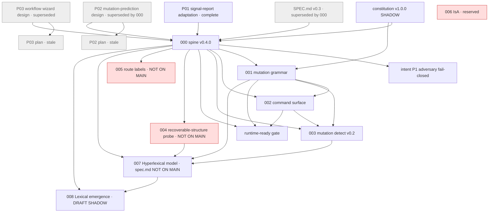

# Hyperlex spec DAG

Machine-readable index: [`index.yaml`](index.yaml). Every spec file now carries `id` / `status` / `depends_on` front matter.
Rule: `depends_on` lists direct prerequisites only. A spec sits after everything it depends on. Edges come from each spec's own `Depends on` line or explicit references. None were invented. No content was rewritten.

No org-wide spec-DAG convention was found (the vault's Research-DAG convention covers research claims, not specs; Noema's capability graph is product data). This follows the `depends_on` + status shape requested 2026-10-15.

## Topological order

`constitution` → `P01` → `P02` → `P02-plan` → `P03` → `P03-plan` → `legacy-v0.3` → `000` → `intent-p1` → `001` → `002` → `003` → `runtime-ready` → `004`* → `005`* → `006`* → `007` → `008`

\* not on `main` (see Problems). Cycle check: **none** (checked by script).

## Moves in this change (git mv, history kept)

| From | To |
|---|---|
| `docs/superpowers/specs/2026-08-06-signal-report-adaptation.md` | `specs/pre-sdd/P01-signal-report-adaptation.md` |
| `docs/superpowers/specs/2026-08-06-mutation-prediction-design.md` | `specs/pre-sdd/P02-mutation-prediction-design.md` |
| `docs/superpowers/plans/2026-08-06-mutation-prediction.md` | `specs/pre-sdd/P02-mutation-prediction-plan.md` |
| `docs/superpowers/specs/2026-08-08-hermes-workflow-wizard-design.md` | `specs/pre-sdd/P03-hermes-workflow-wizard-design.md` |
| `docs/superpowers/plans/2026-08-08-hermes-workflow-wizard.md` | `specs/pre-sdd/P03-hermes-workflow-wizard-plan.md` |

SDD numbers 000–007 already run in topological order, so they keep their numbers.

## Problems found (listed, not resolved)

### Missing / broken targets
1. **007 `spec.md`, `clarify.md`, `plan.md`, `hardware.md`, `AARON-SPARK-TRAIN.md` are not on `main`.** They exist only on `origin/personal-archive*` branches. Still referenced by `milestones.md` ("Locked spec: `spec.md`"), `SPARK-BRINGUP.md`, `HERMES-SPARK-RUN.md`, and `docs/specs/index.md`. Those links are broken on main.
2. **004 and 005 are not on `main`.** 004 is only on `origin/personal-archive/004-recoverable-structure-probe`. 005 points at PR 18 on the archived `scrimshawlife-ctrl/Hyperlex`. 007 depends on 004 (amendments, engineering, milestones).
3. `docs/specs/index.md` linked to the archived `scrimshawlife-ctrl/Hyperlex`. **Fixed** to `Zero-State-LLC/Hyperlex`. Other docs (`CANONICAL.md`, `status.md`, `shadow-hyperlexical.md`, `NAMING.md`, …) still link to the old repo. Left alone because they are not specs.

### Duplicates
4. `NEXT_MOVES_007.md` (root) is byte-identical to `specs/007-hyperlexical-model/NEXT_MOVES_007.md`.
5. `SPEC.md` and `docs/spec.md` are the same v0.3 spec. Only the relative link differs. Both are superseded by 000.
6. `.github/PULL_REQUEST_TEMPLATE.md` and `.github/pull_request_template.md` both exist.

### Contradictions
7. `007/tasks.md` says "U1 + U2 + U3 harness on branch `007-hyperlexical-model`. Not merged to main." `007/status.md` and `docs/specs/index.md` say "Implement U1–U3 harness is on `main`."
8. `007/milestones.md` (2026-09-10) says `name_gate` "stays **false** until Danny yes". `status.md`, `NEXT_MOVES_007.md`, `model-card.draft.md` and amendment A6 say `name_gate` **true** for `seed-morph78` (2026-09-24). Milestones was never updated.
9. `runtime-ready.md` scopes out GAME_ENCODE, watch jsonl and `--human`. `specs/README.md` reports them as implemented in 003 (SHADOW). The gate file is now stale against 003.
10. Index tables disagree: `specs/README.md` lists 000–003 only, while `docs/specs/index.md` lists 000–007.

### Stale
11. `P02-plan` and `P03-plan` are executed plans with unchecked boxes. P02 and P03 designs still say "Draft for approval" although both features shipped (000 cites `mutation_prediction`; 002 lists `wizard`).
12. `007/HYPERLEXICAL-PRODUCT-PLAN.md` is still `DRAFT (operator review)` after the 2026-09-24 reconciliation.

### Orphans
13. `intent/2026-09-05-p1-adversary-fail-closed.md`: no spec references it.
14. `P01` signal-report adaptation: no spec cites it by path. Edge to 000 is inferred from the 0.4.x target.
