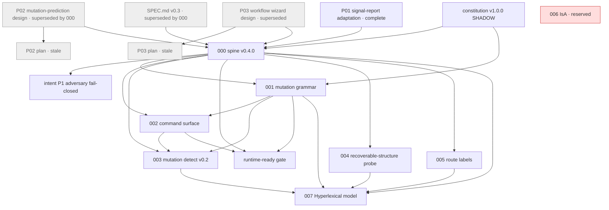

# Hyperlex spec DAG

Machine-readable index: [`index.yaml`](index.yaml). Every spec file now carries `id` / `status` / `depends_on` front matter.
Rule: `depends_on` lists direct prerequisites only. A spec sits after everything it depends on. Edges come from each spec's own `Depends on` line or explicit references. None were invented. No content was rewritten.

No org-wide spec-DAG convention was found (the vault's Research-DAG convention covers research claims, not specs; Noema's capability graph is product data). This follows the `depends_on` + status shape requested 2026-10-15.

## Topological order

`constitution` → `P01` → `P02` → `P02-plan` → `P03` → `P03-plan` → `legacy-v0.3` → `000` → `intent-p1` → `001` → `002` → `003` → `runtime-ready` → `004` → `005` → `006`* → `007`

\* reserved, no file. 004, 005 and the 007 core files were restored to `main` on 2026-10-15 (see Restored). Cycle check: **none** (checked by script).

## Moves in this change (git mv, history kept)

| From | To |
|---|---|
| `docs/superpowers/specs/2026-08-06-signal-report-adaptation.md` | `specs/pre-sdd/P01-signal-report-adaptation.md` |
| `docs/superpowers/specs/2026-08-06-mutation-prediction-design.md` | `specs/pre-sdd/P02-mutation-prediction-design.md` |
| `docs/superpowers/plans/2026-08-06-mutation-prediction.md` | `specs/pre-sdd/P02-mutation-prediction-plan.md` |
| `docs/superpowers/specs/2026-08-08-hermes-workflow-wizard-design.md` | `specs/pre-sdd/P03-hermes-workflow-wizard-design.md` |
| `docs/superpowers/plans/2026-08-08-hermes-workflow-wizard.md` | `specs/pre-sdd/P03-hermes-workflow-wizard-plan.md` |

SDD numbers 000–007 already run in topological order, so they keep their numbers.

## Restored 2026-10-15 (latest version across `origin/personal-archive*`)

| File | Commit | Branch |
|---|---|---|
| `specs/004-recoverable-structure-probe/spec.md`, `tasks.md` | f8f0ef0 | personal-archive-2026-10-09 (also `personal-archive/004-recoverable-structure-probe` and others) |
| `specs/005-route-labels/spec.md`, `tasks.md`, `contracts/route_labels.v0.1.json` | 8b7f603 | personal-archive-2026-10-09 |
| `specs/007-hyperlexical-model/spec.md` | 67fc3a5 | personal-archive-2026-10-09 (originally `docs/vernacular-verdict-rules-v1.4`) |
| `specs/007-hyperlexical-model/clarify.md` | 1a629fc | personal-archive-2026-10-09 (also `feat/pytrends-evidence`) |
| `specs/007-hyperlexical-model/plan.md` | 15ce826 | personal-archive-2026-10-09 |
| `specs/007-hyperlexical-model/hardware.md` | 07af1cf | personal-archive-2026-10-09 |
| `specs/007-hyperlexical-model/AARON-SPARK-TRAIN.md` | f2dfd01 | personal-archive-2026-10-09 (originally `cursor/select-001-holdout-admit-41af`) |

Content is verbatim except for added front matter.

## Cleanup done 2026-10-15
- Removed duplicate root `NEXT_MOVES_007.md`; the 007 copy is kept, and two "root" references in 007 now point to it.
- Removed tracked `docs/spec.md`. `docs.yml` regenerates it from `SPEC.md` before `mkdocs build`, so existing `spec.md` links inside `docs/` still resolve. Added it to `.gitignore`.
- Removed `.github/pull_request_template.md`. Its content differed from the uppercase file, so the newer one was kept: `PULL_REQUEST_TEMPLATE.md` (2026-09-03, vs 2026-08-09).
- P02/P03 marked `superseded`, and their plans marked `stale (archived)`, in front matter.
- Swept `scrimshawlife-ctrl/Hyperlex` → `Zero-State-LLC/Hyperlex` in docs, README, STATUS, mkdocs.yml, constitution and 007 procedure docs. Left alone on purpose: schema `$id`s (identifiers), dated receipts (historical records), and `docs/remotes.md` (describes the archived remote).
- Cycle check re-run: none.

## Open for Danny (not resolved)

### Contradictions
1. `007/tasks.md` says "U1 + U2 + U3 harness on branch `007-hyperlexical-model`. Not merged to main." `007/status.md`, `007/spec.md` and `docs/specs/index.md` say the implement harness is on `main`.
2. `007/milestones.md` (2026-09-10) says `name_gate` "stays **false** until Danny yes". Amendment A6, `spec.md`, `status.md`, `NEXT_MOVES_007.md` and `model-card.draft.md` say `name_gate` is **true** for `seed-morph78` (2026-09-24).
3. `runtime-ready.md` scopes out GAME_ENCODE, watch jsonl and `--human`. `specs/README.md` reports them as implemented in 003 (SHADOW).
4. `specs/README.md` lists only 000–003; `docs/specs/index.md` lists 000–007.

### Other
- 004 status text says "implement on branch `004-recoverable-structure-probe`", and 005 says "implement in PR". The specs are now on main, but their implementation status was not checked or changed.
- `HYPERLEXICAL-PRODUCT-PLAN.md` still says `DRAFT`.
- Orphans: `intent/2026-09-05-p1-adversary-fail-closed.md` is cited by no spec. P01 is not cited by path; its edge to 000 is inferred.
